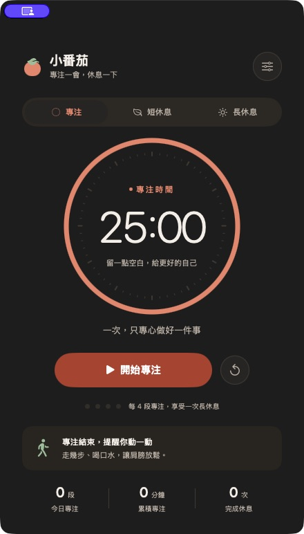

# 小番茄 · Tomato Clock

**專注一會，起來動一動。**

簡潔的原生 macOS 蕃茄鐘。用清楚的圓形倒數陪你專注，時間到了，提醒你離開螢幕、走幾步、喝水與伸展肩頸。

使用 SwiftUI / AppKit，macOS 14 或更新版本，沒有第三方套件、不需要網路或帳號。



## 下載與安裝

前往 [GitHub Releases](https://github.com/brucechou1983/tomato-clock-mac/releases) 下載 `Tomato-Clock-1.0.0-arm64.dmg`。

1. 打開 DMG，將 **Tomato Clock.app** 拖曳到 **Applications（應用程式）**。
2. 從「應用程式」開啟小番茄，按下「開始專注」。
3. 首次開始時允許系統通知，才能收到通知橫幅與提示音。

| 項目 | 支援 |
| --- | --- |
| 系統 | macOS 14 或更新版本 |
| 處理器 | Apple Silicon；v1.0.0 未提供 Intel 安裝檔 |
| 網路／帳號 | 使用 app 不需要網路或帳號 |
| 簽名 | 本機 ad-hoc 簽名，尚未做 Developer ID 簽名與 Apple 公證 |

已建置的 app 在 `build/Tomato Clock.app`，雙擊即可開啟，也可以拖曳到「應用程式」資料夾。

```sh
open "build/Tomato Clock.app"
```

從網路下載後，macOS Gatekeeper 可能阻擋開啟。確認信任此 repository 的來源後，可在「系統設定 → 隱私權與安全性」查看系統提示。

## 使用

- 預設專注 **25 分鐘**、短休息 **5 分鐘**、長休息 **15 分鐘**，都可在設定調整。
- 按「開始專注」。空白鍵開始／暫停，`⌘P` 也可以控制計時，`⌘,` 開啟設定。
- 專注結束會顯示「該起來動一動了」視窗，提醒走路、喝水、伸展肩頸。按「開始休息」才開始休息倒數。
- 每完成 4 段專注，接續一次長休息。休息結束會提醒開始下一段，需自行按下開始。
- 首次開始時可允許系統通知。不允許通知也會有獨立提醒視窗；通知橫幅與聲音仍受 macOS 通知／勿擾設定影響。
- 關閉主視窗後，選單列仍持續計時；點選選單列圖示可暫停、繼續或再次開啟主視窗。真正結束 app 時會暫停並保留進度。
- 切換模式或重設進行中的計時會先確認。未完成的段落不計入統計。
- 設定、進度與最近 90 天的完成紀錄保存在本機 UserDefaults。今日統計依 Mac 的本地時區計算。
- 支援系統深／淺色模式、VoiceOver 標籤與減少動態效果設定。

| 快捷鍵 | 操作 |
| --- | --- |
| 空白鍵 | 在主視窗開始／暫停 |
| `⌘P` | 開始／暫停 |
| `⌘,` | 開啟設定 |
| `⌘1` | 顯示主視窗 |

## 從原始碼建置

需要 Xcode 的 Swift 6 工具鏈。

```sh
git clone https://github.com/brucechou1983/tomato-clock-mac.git
cd tomato-clock-mac
./scripts/build-app.sh
open "build/Tomato Clock.app"
```

Debug 版本：`./scripts/build-app.sh debug`。

產生 DMG 及 SHA-256 校驗檔：`./scripts/package-dmg.sh`。

建置腳本會編譯、繪製 app 圖示、包裝 `.app` 並完成本機 ad-hoc 簽名；不需要開發者帳號。`Package.swift` 也可用 Xcode 開啟。系統通知需要 app bundle，請用建置腳本包裝後執行，勿直接執行裸 SwiftPM binary。

## 驗證

```sh
./scripts/test.sh
```

核心測試涵蓋 deadline 倒數、睡眠後補算、暫停與續跑、完成時暫停的競態、第 4 段的長休息、重設／切換、設定變更、進度保存以及跨午夜的今日統計。

本機驗證（2026-10-13，Apple Silicon／macOS 26.5.1）：12 項核心測試通過；已實際操作原生 app，驗證 1 分鐘專注完成後的起身視窗、從提醒開始休息、休息完成提醒、暫停／續跑、取消模式切換與主視窗重新開啟。實際 UI 驗證使用深色模式；深淺色主要文字與按鈕的色彩對比都通過 4.5:1。系統通知權限與通知橫幅沒有在隔離測試版中啟用，首次正式使用時需允許通知。

可用隔離 UI 驗證模式測試操作，不寫入個人設定／紀錄、不要求系統通知權限：

```sh
open "build/Tomato Clock.app" --args --ui-test
```

若執行環境無法傳入 launch arguments，也可用 `./scripts/build-app.sh release ui-test` 建置獨立的 `build/Tomato Clock QA.app`。此 app 使用不同的 bundle identifier，預設隔離個人紀錄與系統通知。

計時依實際截止時間計算。Mac 睡眠時無法保證叫醒或顯示提醒；喚醒後會立即補算，至多完成原本的一段，不會自動累加多段專注。

## 發布 v1.0.0

在一般 macOS Terminal 執行，需要 Xcode、Git、[GitHub CLI](https://cli.github.com/) 與此 repository 的寫入權限。

```sh
./scripts/release.sh --check  # 僅檢查本機前置條件
./scripts/release.sh
```

腳本會測試、建置 DMG、提交本專案的原始碼與文件、推送 `main` 和 `v1.0.0` tag，再上傳 DMG／校驗檔並發布 Release，最後安裝到「應用程式」並開啟 app。如果 GitHub CLI 尚未登入，先執行 `gh auth login --hostname github.com`。

腳本不含 secrets，也不讀出或印出 token。它使用 Git 與 GitHub CLI 既有登入；不會 force-push、移動既有 tag 或覆寫已發布的 Release。若中途失敗，可以在修正問題後重新執行；已完成的相同版本會檢查後略過。
